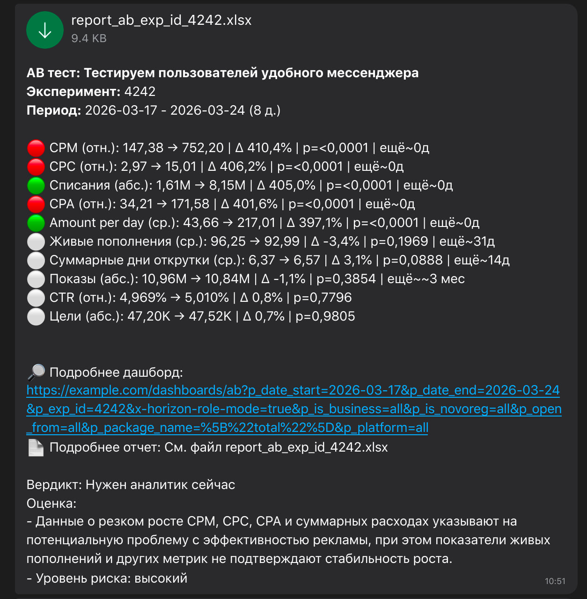
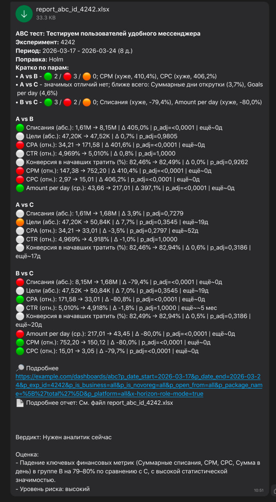
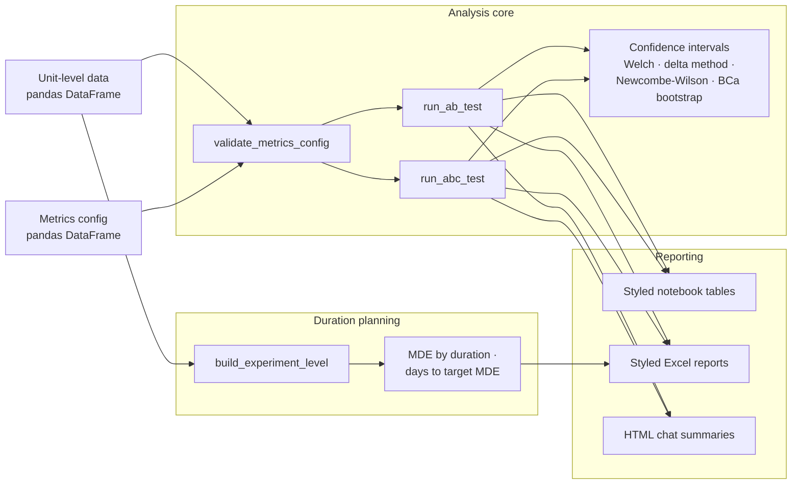

English | [Русский](README_RU.md)

# fast_exp_analytics

**A Python toolkit for A/B, A/B/C and multi-group experiment analysis: statistics, confidence intervals, MDE and duration planning, Excel reports, and chat-ready summaries — designed around analyst workflows in Jupyter.**

<p align="center">
  <a href="https://pypi.org/project/fast-exp-analytics/"></a>
  
  <a href="https://github.com/klipbn/fast_exp_analytics/actions/workflows/ci.yml"></a>
  <a href="https://github.com/klipbn/fast_exp_analytics/blob/main/LICENSE"></a>
  
</p>

## Overview

Product analysts routinely repeat the same experiment loop: pull unit-level data, decide how each metric is computed, run significance tests, build a report, and write a summary for stakeholders. Most teams end up with a pile of one-off notebooks where every test is calculated slightly differently.

`fast_exp_analytics` turns that loop into a small, consistent pipeline:

1. Bring your own data — any unit-level `pandas.DataFrame` (SQL, ClickHouse, CSV — ingestion stays outside the library).
2. Describe metrics once in a config `DataFrame`: name, type (`additive` / `average` / `ratio` / `share` / `median`), numerator, denominator, and which direction counts as an improvement.
3. Run an A/B, A/B/C or A/B/C/D analysis and get p-values, confidence intervals, MDE, achieved power, and projected experiment duration for every metric.
4. Render a styled notebook table, export a formatted Excel report, and generate a short HTML summary for a team chat.

The same metric config drives all of it — statistics, tables, exports, and chat messages — so results are computed the same way every time.

## Features

- **Five metric types with statistics matched to each** — Welch's t-test for additive/average metrics, linearization for ratio metrics (CTR, CPA, CPM), a two-proportion z-test for shares, Mann–Whitney U for medians.
- **Confidence intervals for every metric type** — Welch t-interval, delta method for ratios, Newcombe–Wilson for shares (correct at 0%/100%), reproducible BCa bootstrap for medians.
- **A/B/C, A/B/C/D and N groups out of the box** — all pairwise comparisons with Holm p-value correction and simultaneous (Bonferroni) confidence intervals, omnibus tests, and post-hoc procedures (Dunn, Tukey HSD, Games–Howell, Dunnett).
- **A choice of test per metric** — about 30 criteria selectable in the metrics config: bootstrap, permutation, Yuen, Brunner–Munzel, Fisher, the delta method and more, plus TOST and non-inferiority.
- **Variance reduction and heavy tails** — CUPED, pooled-threshold winsorization, post-stratification.
- **Experiment health checks** — SRM, unit overlap and duplicates, a test recommendation from the data, A/A simulation on your own metric.
- **Honest peeking** — group sequential boundaries (Lan–DeMets) and mSPRT with always-valid p-values and intervals.
- **Decision-oriented output per metric** — MDE, achieved power, required sample size, and an estimate of how many more days the test needs to reach significance.
- **Experiment duration planning** — aggregate raw daily history to any unit level, then estimate MDE for 7/14/21/28+ day runs or the number of days required for a target MDE, including unequal group splits and A/B vs A/B/C sensitivity.
- **Presentation built in** — styled notebook tables, multi-sheet Excel reports with conditional formatting, HTML chat summaries with sign icons and key-metric prioritization.
- **Optional integrations, no hard-coded infrastructure** — send results to a chat and enrich them with an LLM review via explicit config objects (OpenAI-compatible API).
- **Typed, tested, and linted** — `py.typed`, a pytest suite covering the statistics end-to-end, ruff-clean, CI on Python 3.10–3.12.

## Demo

Chat-ready experiment summaries (rendered from the HTML the library produces):

<table align="center">
  <tr>
    <td align="center">
      
      <br><sub>A/B test summary</sub>
    </td>
    <td align="center">
      
      <br><sub>A/B/C test summary</sub>
    </td>
  </tr>
</table>

The repository also ships a full example notebook and generated report files:

| File | Description |
|---|---|
| [`examples/fast_exp_analytics_example.ipynb`](examples/fast_exp_analytics_example.ipynb) | End-to-end workflow: A/B, A/B/C, A/B/C/D, chat messages, Excel export, MDE and duration planning, test selection, CUPED, diagnostics, sequential testing |
| [`examples/report_ab_exp_id_4242.xlsx`](examples/report_ab_exp_id_4242.xlsx) | Example A/B Excel report |
| [`examples/report_abc_id_4242.xlsx`](examples/report_abc_id_4242.xlsx) | Example A/B/C Excel report |
| [`examples/duration_plan_ab.xlsx`](examples/duration_plan_ab.xlsx) | Example duration planning report |

## Installation

```bash
pip install fast-exp-analytics
```

From source:

```bash
git clone https://github.com/klipbn/fast_exp_analytics.git
cd fast_exp_analytics
python -m venv .venv && source .venv/bin/activate
pip install -e .
```

For development (tests, lint, notebook tooling):

```bash
pip install -e ".[dev]"
```

## Quick start

A complete run-through with synthetic data — this exact code executes end-to-end:

```python
import pandas as pd
from fast_exp_analytics import make_synthetic_abc_dataset, run_ab_test, style_table_ab

# 1. Unit-level experiment data (synthetic here; use your SQL/CSV pipeline in practice)
df = make_synthetic_abc_dataset(n=100_000, seed=42)
df_ab = df[df["exp_group"] != "C"]

# 2. Describe the metrics to compare
metrics_df = pd.DataFrame.from_dict(
    {
        "shows":  ["Shows", "additive", "shows",  "shows",  "positive"],
        "ctr":    ["CTR",   "ratio",    "clicks", "shows",  "positive"],
        "amount": ["Amount", "additive", "amount", "amount", "positive"],
        "cpa":    ["CPA",   "ratio",    "amount", "goals",  "negative"],
        "cr":     ["CR to campaign creation", "share", "is_create_ad", "is_in_exp", "positive"],
    },
    orient="index",
    columns=["desc", "type", "num", "den", "direction"],
)

# 3. Run the test
result = run_ab_test(
    df=df_ab,
    metrics_df=metrics_df,
    exp_start_date="2026-03-17",
    exp_end_date="2026-03-24",
    group_base="A",
    group_exp="B",
)

# 4. Inspect the styled table in a notebook
style_table_ab(result, comment="Demo experiment", experiment_id=4242)
```

## Usage

### A/B tests

```python
from fast_exp_analytics import (
    build_ab_chat_message,
    build_dashboard_url_ab,
    export_ab_results_to_excel,
)

# Styled Excel report
export_ab_results_to_excel(
    df_result_ab=result,
    output_path="report_ab.xlsx",
    experiment_desc="Demo experiment",
    exp_id=4242,
    date_from="2026-03-17",
    date_to="2026-03-24",
)

# Short HTML summary for a team chat
msg = build_ab_chat_message(
    df_result=result,
    experiment_desc="Demo experiment",
    exp_id=4242,
    date_from="2026-03-17",
    date_to="2026-03-24",
    dashboard_url="https://example.com/dashboard",
)
print(msg)
```

Input contract: the `df` passed to `run_ab_test` must contain `user_id`, `exp_group`, and every `num`/`den` column referenced by `metrics_df`. Missing columns raise a descriptive `ValueError`.

<details>
<summary><strong>A/B/C tests (multi-group)</strong></summary>

```python
from fast_exp_analytics import (
    build_abc_chat_message,
    export_abc_results_to_excel,
    run_abc_test,
    style_table_abc,
)

result_abc = run_abc_test(
    df=df,
    metrics_df=metrics_df,
    exp_start_date="2026-03-17",
    exp_end_date="2026-03-24",
    include_bc=True,                  # also compare B vs C
    pvalue_adjust_method="holm",      # Holm correction per metric
)

style_table_abc(result_abc, caption="Demo experiment: 2026-03-17 — 2026-03-24")

msg = build_abc_chat_message(
    df_result=result_abc,
    experiment_desc="Demo experiment",
    exp_id=4242,
    date_from="2026-03-17",
    date_to="2026-03-24",
    dashboard_url="https://example.com/dashboard",
    use_adjusted=True,
)

export_abc_results_to_excel(result_abc, "report_abc.xlsx")
```

Each metric is compared across all pairs (`A_vs_B`, `A_vs_C`, and optionally `B_vs_C`). P-values are Holm-corrected per metric, and confidence intervals are widened to simultaneous Bonferroni intervals across the compared pairs.

</details>

<details>
<summary><strong>A/B/C/D and any number of groups</strong></summary>

```python
from fast_exp_analytics import (
    make_synthetic_abcd_dataset, run_abcd_test, run_multigroup_test, run_omnibus_test,
)

df_abcd = make_synthetic_abcd_dataset(n=100_000, seed=42)

run_omnibus_test(df_abcd, metrics_df)          # Welch ANOVA / Kruskal-Wallis / chi-square per metric
result_abcd = run_abcd_test(df_abcd, metrics_df, "2026-03-17", "2026-03-24")   # all 6 pairs

# any number of groups with any names; control-only comparisons give more power
run_multigroup_test(
    df_abcd, metrics_df, "2026-03-17", "2026-03-24", control="A", include_all_pairs=False,
)
```

`run_abcd_test` compares all six pairs (or only control pairs with `include_all_pairs=False`). The Holm correction and Bonferroni intervals scale with the number of pairs. `run_omnibus_test` answers "is there any difference at all"; pairwise runs answer "which pairs differ". If the pairwise hypotheses are pre-planned, a significant omnibus test is not required first.

</details>

<details>
<summary><strong>Choosing the test, CUPED and winsorization</strong></summary>

Defaults are unchanged: `additive`/`average` use Welch, `ratio` uses linearization, `share` a two-proportion z-test, `median` Mann–Whitney. Three optional config columns change that per metric: `test`, `covariate` (CUPED) and `winsorize` (upper quantile, pooled threshold).

```python
import pandas as pd
from fast_exp_analytics import available_tests, run_ab_test

metrics_df = pd.DataFrame(
    [
        # desc, type, num, den, direction, test, covariate, winsorize
        ["Amount", "average", "amount", "is_in_exp", "positive", None, "amount_pre", 0.99],
        ["Amount (bootstrap)", "average", "amount", "is_in_exp", "positive", "bootstrap", None, None],
        ["CTR", "ratio", "clicks", "shows", "positive", "delta", None, None],
        ["CR to spend", "share", "is_with_spents", "is_in_exp", "positive", "fisher", None, None],
    ],
    index=["amount", "amount_boot", "ctr", "cr"],
    columns=["desc", "type", "num", "den", "direction", "test", "covariate", "winsorize"],
)

result = run_ab_test(
    df_ab, metrics_df, "2026-03-17", "2026-03-24",
    extended=True,                 # + test_name, statistic, effect_size, rel_ci_*, delta_cuped, ...
    metrics_adjust_method="holm",  # correction across metrics: p_value_adj, result_adj
)
available_tests()                  # allowed `test` values per metric type
```

| Metric type | `test` values |
|---|---|
| `additive`, `average` | `welch` (default), `student`, `ztest`, `yuen`, `bootstrap`, `permutation`, `mannwhitney`, `brunner_munzel`, `ks`, `cvm` |
| `ratio` | `linearization` (default), `delta`, `bootstrap` |
| `share` | `ztest` (default), `chi2`, `chi2_yates`, `g_test`, `fisher`, `boschloo`, `barnard` |
| `median` | `mannwhitney` (default), `brunner_munzel`, `mood`, `bootstrap`, `permutation`, `ks`, `cvm` |
| 3+ groups, additionally | `dunn` (`additive`/`average`/`median`), `tukey`, `games_howell`, `dunnett` (`additive`/`average`) |

How to choose:

- **A question about the mean** (money, counts per unit): `welch`. With a heavy tail and too small a sample (`n < 355 * skewness^2`) use `bootstrap` or `permutation` together with `winsorize` and CUPED. `recommend_test(control, experiment, metric_type)` applies this rule to your data.
- **Rank tests** (`mannwhitney`, `brunner_munzel`, `dunn`) answer a question about the rank position of the distributions, not about means and not always about medians. The reported CI stays the interval for the metric delta.
- **Shares**: `ztest`; with expected counts below 5 use `fisher`.
- **CUPED** (`covariate`): the pre-experiment value of the metric. p-value, CI, MDE and power use adjusted values, point estimates stay raw; the adjusted delta is in `delta_cuped`.
- `tukey`, `games_howell` and `dunnett` already control the family-wise error across pairs, so they are not corrected a second time.

</details>

<details>
<summary><strong>Design checks, sequential testing, sample size</strong></summary>

```python
from fast_exp_analytics import (
    check_unit_overlap, describe_groups, group_sequential_boundaries, msprt_sequence,
    power, recommend_test, simulate_aa, srm_check_df,
)

srm_check_df(df_ab, expected_shares={"A": 0.5, "B": 0.5})   # is_srm=True -> do not trust the results
check_unit_overlap(df_ab)                                   # units in several groups, duplicated rows
describe_groups(df_ab, "amount")                            # quantiles, share of zeros, top-1% share
simulate_aa(df_ab["amount"], test="welch")                  # empirical type I error on your own data

group_sequential_boundaries([0.25, 0.5, 0.75, 1.0])         # boundaries for planned interim looks
msprt_sequence(deltas, ses, tau=mde_abs)                    # always-valid p-values for daily peeking
power.sample_size_proportions(0.10, mde_rel=0.05, n_comparisons=2)
```

Standalone modules: `stat_tests` (about 30 two-sample tests returning one `StatTestResult`), `multi_group` (omnibus and post-hoc procedures), `multiple_testing`, `effect_sizes`, `variance_reduction`, `diagnostics`, `sequential`, `bayesian`, `power`.

</details>

<details>
<summary><strong>Experiment duration planning (MDE)</strong></summary>

```python
from fast_exp_analytics import (
    build_experiment_level,
    default_duration_metrics_config,
    duration_plan_summary,
    export_duration_results_to_excel,
)

# Aggregate daily history to the experiment unit level
agg_df = build_experiment_level(
    df_raw,                 # daily rows: user_id, date, amount, shows, clicks, main_goals
    unit_id_col="user_id",
    entity_id_col="campaign_id",
)

# MDE achievable for different run lengths, and days needed for a target MDE
plan = duration_plan_summary(
    df_raw,
    unit_id_col="user_id",
    rollout_pct=0.5,                # share of traffic in the experiment
    exp_days=[7, 14, 21, 28, 35],
    target_mde_pct=[5, 7, 10],
    experiment_type="ab",           # or "abc"; supports unequal group_shares
    metrics_config=default_duration_metrics_config(),
)

export_duration_results_to_excel(
    output_path="duration_plan.xlsx",
    mde_by_days_df=plan["mde_by_days"],
    days_for_target_mde_df=plan["days_for_target_mde"],
    experiment_name="Budget recommendations",
    recommended_days=21,
)
```

The Excel report includes a manager-readable summary sheet alongside the raw tables. Custom metrics are added by extending the config with a `source_col` and an optional `log1p` transform.

</details>

<details>
<summary><strong>Optional integrations: chat delivery and LLM review</strong></summary>

```python
import os
from fast_exp_analytics import ChatSendConfig, OpenAICompatConfig, build_llm_review, send_chat_message

# Generic chat API (token passed explicitly, never hard-coded)
chat_config = ChatSendConfig(api_base_url="https://chat-api.example.com/bot/v1", token=os.environ["CHAT_BOT_TOKEN"])
send_chat_message(config=chat_config, message=msg, chat_id="my-chat-id", file_path="report_ab.xlsx")

# LLM review via any OpenAI-compatible endpoint
llm_config = OpenAICompatConfig(
    api_key=os.environ["OPENAI_API_KEY"],
    base_url="https://api.openai.com/v1",
    model="gpt-4o-mini",
)
review = build_llm_review(config=llm_config, system_prompt="You are an A/B test analyst.", user_prompt=msg)
```

Both integrations require their packages/credentials to be provided by the caller; the library core has no network dependencies beyond `requests` and takes no action on its own.

</details>

## Architecture



- **`config.py`** — validates the metric config (allowed types, directions, unique names) and provides a default metric set.
- **`ab.py` / `abc.py`** — the statistical engine: per-metric-type preprocessing, tests, MDE/power/sample-size math, result tables. The multi-group engine adds pairwise comparisons and multiple-testing correction for any number of groups.
- **`stat_tests.py` / `multi_group.py`** — the test library the engines dispatch to: two-sample criteria with a single result type, omnibus tests and post-hoc procedures.
- **`variance_reduction.py` / `diagnostics.py` / `sequential.py` / `power.py` / `bayesian.py`** — standalone tools around the test: CUPED and winsorization, SRM and design checks, peeking-safe inference, sample size planning, Bayesian summaries.
- **`confidence_intervals.py`** — one implementation of interval estimation shared by both engines.
- **`reporting*.py`** — pure formatting: notebook tables, dashboard URL builders, HTML chat messages with icon and key-metric logic.
- **`exporters*.py`** — Excel rendering (openpyxl): styled headers, number formats, conditional formatting, summary sheets.
- **`duration.py`** — history aggregation and MDE/duration estimates on top of the same z-statistics.
- **`llm.py` / `messaging.py`** — optional integrations, isolated behind explicit config objects.

## Statistical methods

| Metric type | Point estimate | Significance test | CI for the difference |
|---|---|---|---|
| `additive` | sum per group | Welch's t-test | Welch t-interval |
| `average` | mean per unit | Welch's t-test | Welch t-interval |
| `ratio` (CTR, CPA, …) | ratio of sums, linearized against control | Welch's t-test on linearized values | Delta method with influence functions |
| `share` | success share | Two-proportion z-test | Newcombe–Wilson (valid at 0% / 100%) |
| `median` | median per unit | Mann–Whitney U | BCa bootstrap (reproducible seed) |

These are the defaults; the `test` column of the metrics config selects an alternative per metric (see "Choosing the test, CUPED and winsorization"). For `additive` metrics the delta of sums is scaled to the control group size, so unequal group sizes do not show up as an effect.

MDE and sample-size estimates use the standard two-sample formula with the harmonic mean of group sizes; ratio MDE is expressed relative to the control denominator mean.

## Example output

`result` from the quick start (selected columns):

| metric_name | value_base | value_exp | rel_delta | p_value | result | ci_lower | ci_upper |
|---|---:|---:|---:|---:|---|---:|---:|
| Amount | 1 614 609 | 8 153 601 | +401.9% | <0.0001 | positive | 190.25 | 204.09 |
| CPA | 34.21 | 171.58 | +401.6% | <0.0001 | negative | 129.10 | 145.63 |
| CTR | 4.969% | 5.010% | +0.8% | 0.7796 | neutral | -0.0024 | 0.0032 |

`build_ab_chat_message` renders (HTML, shown as it appears in the chat client):

```text
🟢 Amount (абс.): 1,61M → 8,15M | Δ 401,9% | p=<0,0001
🔴 CPA (отн.): 34,21 → 171,58 | Δ 401,6% | p=<0,0001
⚪ CTR (отн.): 4,969% → 5,010% | Δ 0,8% | p=0,7796
```

Icons encode the verdict: 🟢 significant improvement, 🔴 significant degradation, 🟠 near-significant or a large observed effect, ⚪ neutral.

## Project structure

```text
fast_exp_analytics/          # library package
├── ab.py                    # A/B statistical engine
├── abc.py                   # multi-group engine: A/B/C, A/B/C/D, N groups, omnibus tests
├── stat_tests.py            # two-sample tests + per-metric-type dispatcher
├── multi_group.py           # omnibus tests and post-hoc procedures for 3+ groups
├── multiple_testing.py      # FWER / FDR p-value adjustments
├── effect_sizes.py          # effect sizes, relative-lift confidence intervals
├── variance_reduction.py    # CUPED, winsorization, post-stratification
├── diagnostics.py           # SRM, design checks, test recommendation, A/A simulation
├── sequential.py            # group sequential boundaries, mSPRT
├── bayesian.py              # probability to win, expected loss
├── power.py                 # sample size, MDE, power
├── confidence_intervals.py  # CI methods shared by both engines
├── config.py                # metrics config validation + defaults
├── datasets.py              # synthetic data generator for demos/tests
├── duration.py              # duration planning: aggregation, MDE, required days
├── reporting.py             # A/B/C chat messages + dashboard URLs
├── reporting_ab.py          # A/B chat messages + dashboard URLs
├── exporters.py             # A/B/C Excel export
├── exporters_ab.py          # A/B Excel export
├── exporters_duration.py    # duration planning Excel export
├── llm.py                   # optional OpenAI-compatible LLM review
└── messaging.py             # optional chat delivery
examples/                    # example notebook, sample reports, demo screenshots
tests/                       # pytest suite
```

## Tech stack

| Area | Technology |
|---|---|
| Language | Python 3.10+ |
| Data / statistics | pandas, NumPy, SciPy, statsmodels |
| Reporting | openpyxl (Excel), pandas Styler |
| HTTP integrations | requests, openai (optional) |
| Testing | pytest |
| Linting | ruff |
| Packaging | setuptools, pyproject.toml |

## Configuration

The library core requires no configuration or credentials. The optional integrations used in the example notebook read tokens from the environment:

| Variable | Required | Description |
|---|---:|---|
| `CHAT_BOT_TOKEN` | No | Token for `send_chat_message` (chat delivery integration) |
| `OPENAI_API_KEY` | No | Key for `build_llm_review` (OpenAI-compatible API) |

```bash
cp .env.example .env   # then fill in only what you use
```

## Tests

```bash
pytest
```

The suite covers the confidence interval formulas against reference computations, every two-sample and post-hoc test against scipy / statsmodels references, group sequential boundaries against published tables, mSPRT type I error under continuous peeking, all metric types end-to-end through `run_ab_test` / `run_abc_test` / `run_abcd_test`, CUPED and winsorization in the pipeline, ABC correction behavior, Excel column placement, config validation, duration planning math, and chat message formatting.

## Development

```bash
ruff check fast_exp_analytics tests   # lint
ruff format fast_exp_analytics tests  # format (line length 100)
pytest                                # tests
```

CI runs lint and tests on Python 3.10, 3.11, and 3.12.

## Design decisions

- **One config drives everything.** Metrics are described declaratively (`desc`, `type`, `num`, `den`, `direction`), and the same config is consumed by the statistics engine, notebook tables, Excel exports, and chat summaries. Adding a metric is one row, not five edits.
- **Statistics matched to metric semantics, not one universal test.** Ratio metrics are linearized against control before testing; shares get Newcombe–Wilson intervals that stay valid at boundary proportions; medians get a seeded BCa bootstrap instead of a normal approximation. Correctness at the edges was the priority (see `CHANGELOG.md` for the evolution).
- **Data ingestion stays outside the library.** The API takes unit-level DataFrames only, so the package works with any warehouse or file format and remains testable without infrastructure.
- **Integrations are explicit, never ambient.** Chat and LLM delivery take config objects with credentials from the caller. The core has no endpoints, no environment reads, and no side effects.
- **Presentation is a first-class output.** In practice the deliverable is a message a manager can read in 10 seconds; icon logic, key-metric prioritization, and "days remaining" hints are part of the library, not post-processing.

## Limitations

- The unit ID column is fixed as `user_id`; other ID columns require renaming before analysis.
- Median metrics get a Mann–Whitney U p-value but no MDE/power estimates (reported as NaN).
- Share metrics use binary success semantics: any `num > 0` counts as a success.
- Built-in message templates and default metric labels are Russian-oriented; key metrics can be overridden via parameters, but templates are not yet localized.
- CUPED and winsorization are wired into the pipeline for `additive` and `average` metrics only; for other types use `variance_reduction` directly.
- With rank tests the reported confidence interval is still the interval for the metric delta, so it can disagree with the p-value.
- `power_now` is power at the observed effect; it carries no information beyond the p-value.
- Docstrings of the newer modules are in Russian.

## Roadmap

- [x] A/B and A/B/C analysis with multiple-testing correction
- [x] Confidence intervals for all metric types
- [x] MDE and duration planning
- [x] Excel / notebook / chat reporting
- [ ] Localizable message templates (English defaults)
- [ ] Configurable unit ID column
- [x] CUPED / pre-experiment variance reduction
- [x] Test selection per metric, post-hoc procedures for 3+ groups
- [x] Sequential testing (group sequential, mSPRT)
- [ ] English docstrings for the newer modules

## License

[MIT](LICENSE) © 2026 Alexey Voronko
